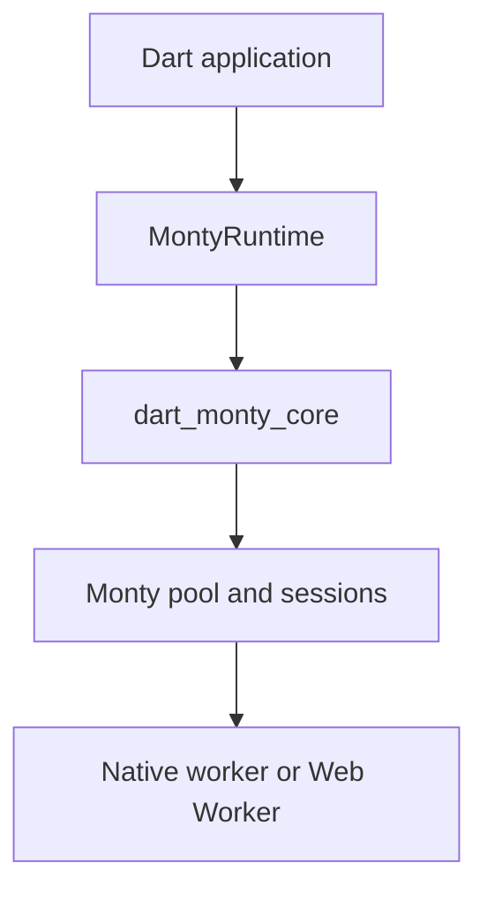
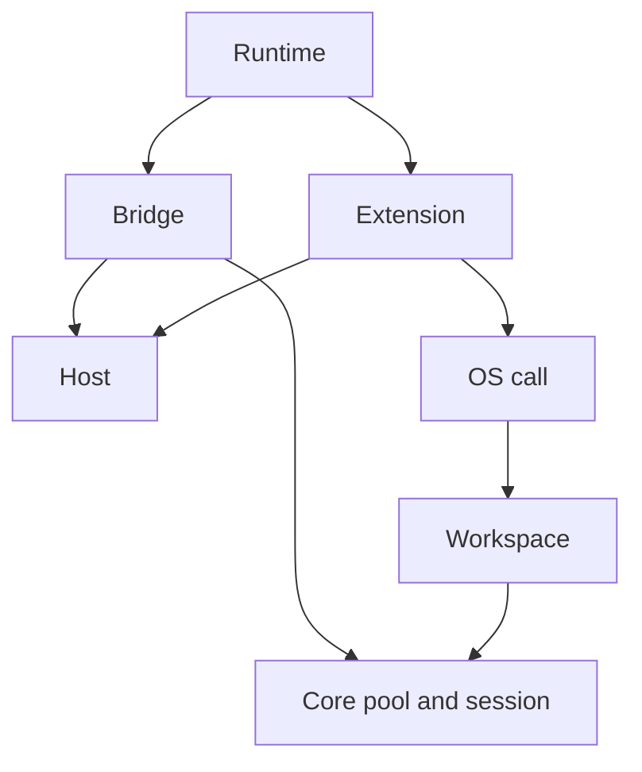
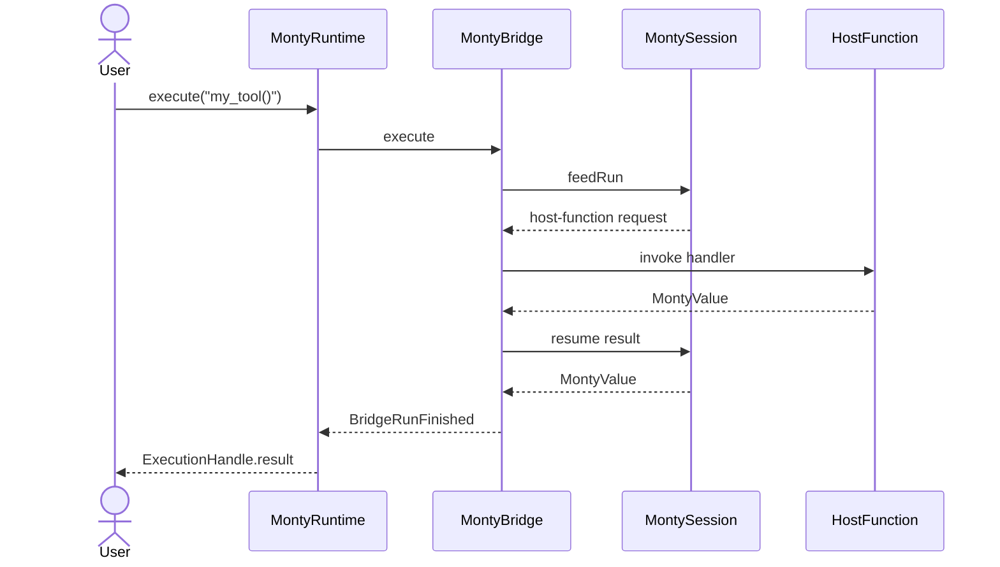

# dart_monty Architecture

## Quick Orientation

dart_monty is a pure Dart package for running sandboxed Python through
`dart_monty_core`. `MontyRuntime` owns the high-level execution interface:
stateful or fresh-session execution, host functions, extensions, OS handlers,
and bridge events.

## Architecture Diagrams

### Diagram 1: High-Level Package Dependency



### Diagram 2: dart_monty Layers



### Diagram 3: Execution Flow for a Host Function



## Internal Module Structure

```text
dart_monty
  │
  ├── lib/src/runtime/       MontyRuntime and ExecutionHandle
  ├── lib/src/bridge/        MontyBridge and BridgeEvent streaming
  ├── lib/src/extension/     MontyExtension attachment and child policy
  ├── lib/src/extensions/    Built-in sandbox and event-loop extensions
  ├── lib/src/host/          Host functions, schemas, parameters, dispatch
  ├── lib/src/os_call/       OS handler composition
  └── lib/src/workspace/     Child workspace ownership and transfers
        │
        ▼
dart_monty_core             Monty pool, MontySession, values, OSAccess
        │
        ▼
native worker or Web Worker
```

## Platform Support Matrix

| Runtime layer | Responsibility | Public entry point |
|---|---|---|
| dart_monty | Runtime lifecycle and application capabilities | `MontyRuntime.start` |
| dart_monty | Python-to-Dart calls and execution events | `MontyBridge`, `HostFunction` |
| dart_monty | Child execution and workspace composition | `SandboxExtension`, `OSAccess` |
| dart_monty_core | Pool, session, values, limits, and worker transport | `Monty`, `MontySession`, `ResourceLimits` |

## Choosing the Right API

| Use case | API | Example |
|---|---|---|
| Stateful Python execution with application capabilities | `MontyRuntime` | `final runtime = await MontyRuntime.start()` |
| Direct core session feed | `Monty` and `MontySession` | `await Monty.withPool((pool) => pool.withSession((session) => session.feedRun('2 + 2')))` |
| Python-callable Dart capability | `HostFunction` | `runtime.register(function)` |

## Tool Calling & LLM Integration

`MontyRuntime` registers `HostFunction` values with its bridge. A function has
a `HostFunctionSchema` for tool definitions and a handler that returns a
`MontyValue` when Python calls the function. `runtime.schemas` exposes the
registered schemas, and `runtime.events` exposes execution and host-call
events.

`OsHandler` handles OS calls from Python. Extensions contribute handlers with
`MontyExtension.osContribution`, or register one during attachment through
`AttachContext.registerOs`.

See [OsCall / VFS Layer](../deep-dives/oscall-vfs.md) for workspace and OS
access policy.
