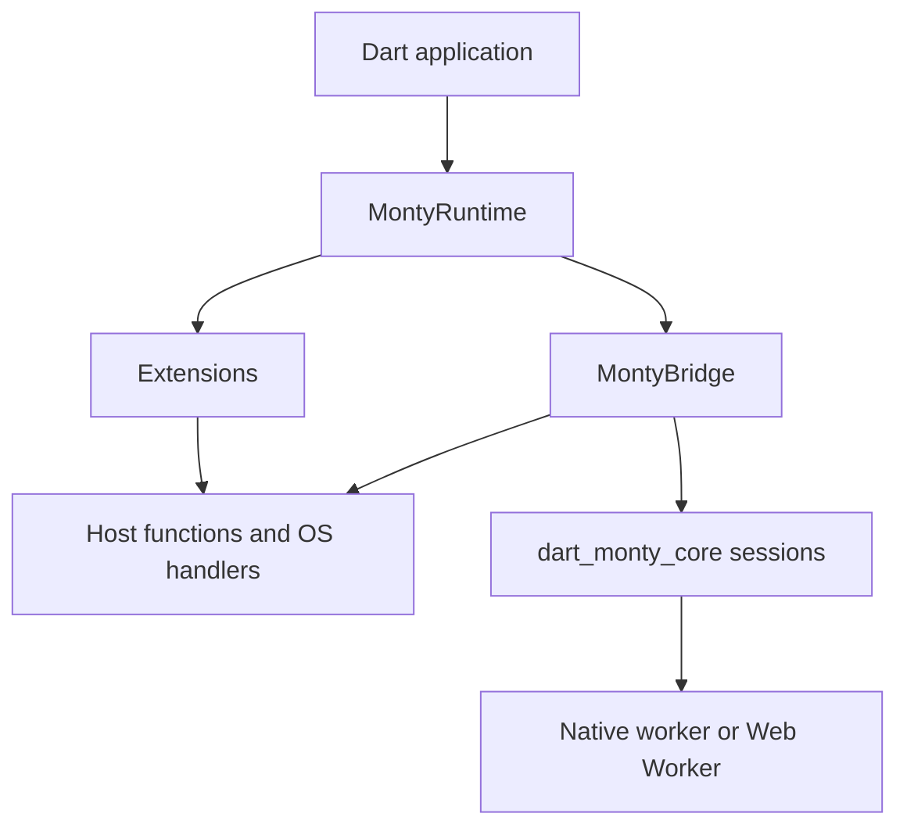

# Architecture

The package boundary is defined in
[Core and dart_monty ownership](core-boundary.md).

`MontyRuntime` is the application-level API. Choose it when Python needs Dart
capabilities, execution events, or state that spans calls. Applications that
need none of those features can use core's pool and session API directly.

A host-function call suspends Python while the bridge dispatches Dart work and
then resumes the session. An extension groups those capabilities and
participates in attachment, child creation, and disposal.

[MontyRuntime](https://github.com/runyaga/dart_monty/blob/main/lib/src/runtime/runtime.dart),
[MontyBridge](https://github.com/runyaga/dart_monty/blob/main/lib/src/bridge/bridge.dart),
[HostFunction](https://github.com/runyaga/dart_monty/blob/main/lib/src/host/function.dart),
[MontyExtension](https://github.com/runyaga/dart_monty/blob/main/lib/src/extension/extension.dart),
and [SandboxExtension](https://github.com/runyaga/dart_monty/blob/main/lib/src/extensions/sandbox.dart)
define ownership, dispatch, capabilities, extensions, and child storage.

See [Core and dart_monty ownership](core-boundary.md) for the package boundary,
[Bridge concurrency](../deep-dives/bridge-concurrency.md) for session choices,
and [Filesystem and workspace policy](../deep-dives/oscall-vfs.md) for sandbox
storage guarantees.
