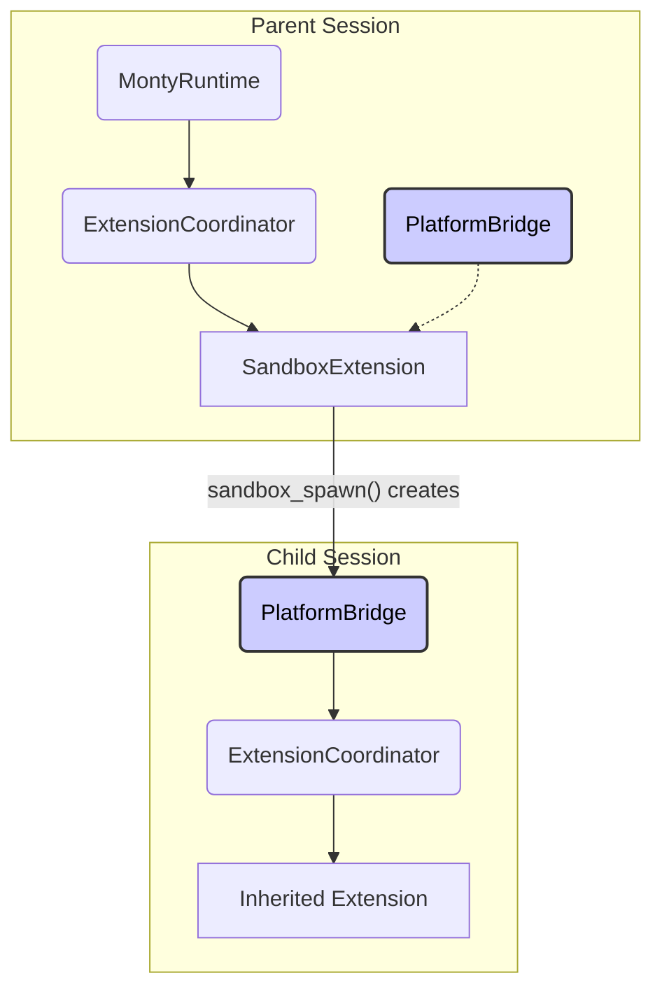

# Sandbox Architecture

## Overview

`SandboxExtension` spawns Python scripts in isolated child interpreters.
Each child gets its own `MontyPlatform` and `PlatformBridge`, and an
`ExtensionCoordinator` for inherited tools. The parent Python script
controls children via host functions.

### Architecture Diagram

This diagram shows how a parent `MontyRuntime` spawns an isolated child session.

### Cross-platform Support

`SandboxExtension` is fully supported on both native (FFI) and web (WASM).

| | Native (FFI) | Web (WASM) |
|---|---|---|
| Child interpreter | Fresh `MontyFfi` instance | Fresh session in its own Web Worker |
| Memory isolation | Separate Rust interpreter state | Separate Rust REPL heap |
| Parallelism | Sequential (parent's event loop) | Concurrent (one Web Worker per child) |

## Host Functions

- `sandbox_spawn(code, timeout_ms?, memory_bytes?, system_prompt?)`
- `sandbox_await(handle)`
- `sandbox_await_all(handles)`
- `sandbox_gather(handles)`
- `sandbox_is_alive(handle)`
- `sandbox_free(handle)`
- `sandbox_get_output(handle)`

## Isolation Model

Each child gets:

- **Own `MontyPlatform`** — A fresh interpreter instance via the `platformFactory`.
- **Own `PlatformBridge`** — An independent dispatch loop and event stream.
- **Own `ExtensionCoordinator`** — A new coordinator with inherited extensions.
- **Own VFS (optional)** — Filesystem access controlled by the `childVfsStrategy`.

## Extension Inheritance

`SandboxExtension` relies on its parent `ExtensionCoordinator` to build the child's environment. It calls `coordinator.spawnChild()`, which iterates through all registered extensions and calls `MontyExtension.createChildInstance()` on each one, allowing them to be cloned for the child.

## Workspace ownership

Each child receives an independent namespace with cwd `/work`. Memory is the
default; `sandboxBaseDir` selects an owned native directory on VM.
`files` and `ro_files` map child-relative destinations to absolute parent
sources; `collect` on `sandbox_await` maps child-relative sources to absolute
parent destinations. Copies are explicit snapshots, and collections are
repeatable. Filesystem calls outside `/work` decline synchronously to core;
they never fall through to the parent filesystem.

See [workspace policy](oscall-vfs.md) for caps, transfer bounds and disposal.

## Browser memory

In a browser every child runs in its own Web Worker, and all workers share one
compiled module. A child adds its own heap and its own workspace, so a
`files` or `ro_files` copy-in is stored once per child. Each copied byte costs
about 6 to 8 times its size in page memory per child on dart2js. On dart2wasm it
costs up to about 11 times at 1 MiB. Keep the copy-in to about 1 MiB per child
when a page runs 16 children.

The figures below come from a page that runs 16 children, each holding one copy
of a fixture file that the child reads once, in headless Chrome. They are the
increase in the largest renderer's memory footprint over the same page before
the children start. The budget is 320 MB, which is 20 MB per child. Three runs at 1 MiB agree within
3 MB. The other rows are single runs.

| Copy-in per child | dart2js | dart2wasm | Within 320 MB |
|---|---|---|---|
| 4 KiB | +119 MB | +116 MB | yes |
| 256 KiB | +145 MB | +166 MB | yes |
| 1 MiB | +221 MB | +285 MB | yes |
| 2 MiB | +376 MB | +371 MB | no |

At 1 MiB the 16 children and the parent peak at 17 live Workers and compile the
worker module once. Every Worker is gone after teardown. A page that needs more
than 1 MiB per child runs fewer children at a time.
