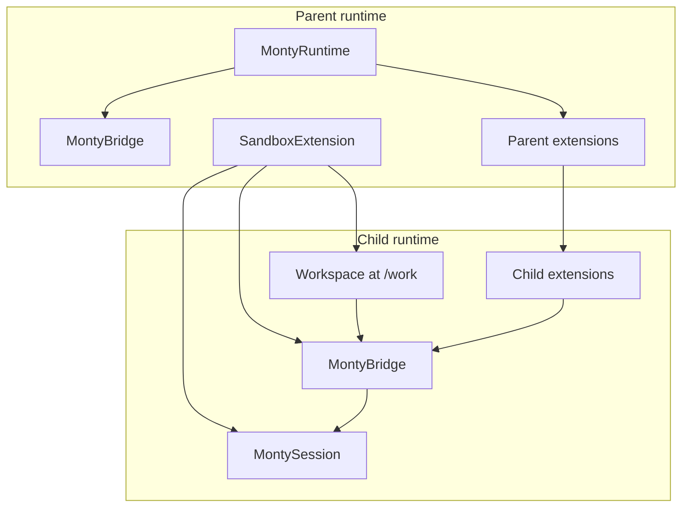

# Sandbox Architecture

## Overview

`SandboxExtension` runs Python scripts in child interpreters. Each child owns
a `MontySession`, a `MontyBridge`, an extension attachment, and a workspace.
The parent Python script controls children through host functions.

### Architecture Diagram

### Cross-platform Support

`SandboxExtension` supports the FFI and WASM backends. A child checks out a
separate core session and receives an independent workspace. Core supplies the
native-worker or Web Worker transport for that session.

## Host Functions

- `sandbox_spawn(code, timeout_ms?, memory_bytes?, files?, ro_files?, write_bytes_limit?, memory_usage_limit?)`
- `sandbox_await(handle, collect?)`
- `sandbox_await_all(handles)`
- `sandbox_gather(handles)`
- `sandbox_is_alive(handle)`
- `sandbox_free(handle)`
- `sandbox_get_output(handle)`

## Isolation Model

Each child owns:

- A checked-out `MontySession` with independent interpreter state.
- A `MontyBridge` that dispatches host calls and emits child events.
- An extension attachment built from the parent extensions' child policies.
- A workspace rooted at `/work`, backed by memory or an owned native directory.

The child bridge uses the child's workspace when it composes OS handling.
Workspace access does not expose the parent workspace unless `files` or
`ro_files` copies selected parent sources into the child.

## Extension Inheritance

`SandboxExtension` asks its attached extension owner to create a child
attachment. Every parent `MontyExtension` declares a `ChildPolicy`:

- `ChildPolicy.exclude` keeps the extension out of the child.
- `ChildPolicy.clone` calls `createChildInstance` with a `ChildSpawnContext`.
- `ChildPolicy.inherit` attaches the parent instance to the child.

`ChildSpawnContext` provides the child identifier and its virtual working
directory. A cloned extension returns a distinct instance and receives its own
attachment lifecycle.

## Workspace ownership

Each child receives an independent namespace with cwd `/work`. Memory is the
default. `sandboxBaseDir` selects an owned native directory on VM.
`files` and `ro_files` map child-relative destinations to absolute parent
sources. `collect` on `sandbox_await` maps child-relative sources to absolute
parent destinations. Copies are explicit snapshots, and collections are
repeatable. Filesystem calls outside `/work` decline synchronously to core and
never fall through to the parent filesystem.

See [workspace policy](oscall-vfs.md) for caps, transfer bounds and disposal.

## Browser memory

In a browser every child runs in its own Web Worker, and all workers share one
compiled module. A child adds its own heap and its own workspace, so a
`files` or `ro_files` copy-in is stored once per child. Each copied byte costs
about 6 to 8 times its size in page memory per child on dart2js. On dart2wasm it
costs up to about 11 times at 1 MiB. Keep the copy-in to about 1 MiB per child
when a page runs 16 children.

The figures below come from a page that runs 16 children, each holding one copy
of a fixture file that the child reads once, in headless Chrome. They are the
increase in the largest renderer's memory footprint over the same page before
the children start. The budget is 320 MB, which is 20 MB per child. Three runs at 1 MiB agree within
3 MB. The other rows are single runs.

| Copy-in per child | dart2js | dart2wasm | Within 320 MB |
|---|---|---|---|
| 4 KiB | +119 MB | +116 MB | yes |
| 256 KiB | +145 MB | +166 MB | yes |
| 1 MiB | +221 MB | +285 MB | yes |
| 2 MiB | +376 MB | +371 MB | no |

At 1 MiB the 16 children and the parent peak at 17 live Workers and compile the
worker module once. Every Worker is gone after teardown. A page that needs more
than 1 MiB per child runs fewer children at a time.
